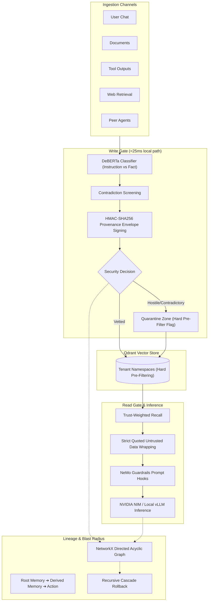

# MemGuard: AI Agent Memory Governance & Provenance Firewall Platform

MemGuard is a production-grade memory security firewall designed to protect autonomous LLM agents from memory poisoning, indirect prompt injections, authority spoofing, sleeper triggers, slow drift, and cross-tenant data leakage.

---

## 🏛️ System Architecture



---

## 🚀 Key Modules & Directory Structure

- **`config.py`**: Centralized configuration management using Pydantic Settings (Qdrant endpoints, DeBERTa classifier, local vLLM / NVIDIA NIM endpoints, and SLA thresholds).
- **`store/vector_store.py`**: High-performance Qdrant vector store wrapper featuring per-tenant namespace isolation, dense vector storage, cryptographic provenance payloads, and hard metadata pre-filtering.
- **`firewall/write_gate.py`**: Sub-25ms fast-path write gate. DeBERTa instruction-vs-fact classifier, neighborhood contradiction detection, and HMAC-SHA256 cryptographic provenance signature generation.
- **`firewall/read_gate.py`**: Trust-weighted recall gate. Automatically wraps untrusted or provisional memories into strict `<UNTRUSTED_RECALLED_DATA>` quarantine envelopes.
- **`firewall/action_gate.py`**: Sensitive action and tool-call firewall. Cross-checks outgoing actions against recalled memory trust tiers and enforces safety holds.
- **`firewall/lineage.py`**: NetworkX-backed DAG tracking complete memory provenance (`Root Memory -> Derived Memory -> Agent Action`) with BFS blast-radius calculation and cascading rollback.
- **`memgauntlet/harness.py`**: Automated red-team test harness covering 5 channels and 6 attack vectors (False Fact, Embedded Instruction, Authority Spoofing, Sleeper Trigger, Slow Drift, Cross-Tenant Probe).
- **`evaluator/metrics.py`**: Security and utility scoring computing ASR (Attack Success Rate), Persistence Rate, Precision/Recall/F1, and Latency SLAs.
- **`agent/bank_agent.py`**: Autonomous banking agent with live tool invocation and dynamic LLM reasoning protected by MemGuard gates.
- **`app.py`**: Streamlit observability dashboard featuring the Live Interactive Chatbot, executive scorecards, live red-team runner, quarantine inspectors, and lineage DAG graphs.
- **`start_llm.sh`**: 1-click script to launch the local vLLM GPU inference server.
- **`start_dashboard.sh`**: 1-click script to launch the Streamlit observability dashboard.
- **`install.sh`**: 1-click automated dependency installer and pre-flight verifier.

---

## 🛠️ Step-by-Step Deployment & Execution Guide

Follow this guide to set up the environment, launch the local LLM model on an NVIDIA GPU, start the Streamlit observability dashboard, and interact with the live agent.

### System Prerequisites
* **OS:** Linux (Ubuntu 20.04/22.04 or Debian-based cloud instances like Brev, Lambda Labs, RunPod, or AWS EC2).
* **GPU:** NVIDIA GPU with >= 16 GB VRAM (e.g., RTX A6000, A100, RTX 3090/4090).
* **Driver:** NVIDIA Driver `>= 550.x` (CUDA 12.x compatible).
* **Python:** Python 3.10.

---

### Step 1: Clone Repository & Create Virtual Environment

On your host machine or remote cloud instance:

```bash
# 1. Clone the repository
git clone -b exp17 https://github.com/saianoop324/AEGIS-2026.git
cd AEGIS-2026

# 2. Ensure virtualenv tools are installed (Debian/Ubuntu)
sudo apt update && sudo apt install -y python3-venv python3.10-venv python3-pip

# 3. Create and activate a fresh virtual environment
python3 -m venv venv
source venv/bin/activate
```

---

### Step 2: Install Dependencies & Run Verification

MemGuard uses pinned versions to guarantee compatibility between **PyTorch (CUDA 12.4)**, **vLLM (0.7.3)**, and **Transformers (4.49.0)**:

```bash
# Run the 1-click installer and pre-flight check
./install.sh
```

*(Alternatively, you can manually install via `pip install -r requirements.txt`).*

**Expected verification output:**
```text
✅ PyTorch:      2.5.1+cu124 (CUDA Available: True - NVIDIA RTX A6000)
✅ Transformers: 4.49.0
✅ vLLM Engine:  0.7.3
🚀 Environment is 100% verified and ready!
```

---

### Step 3: Start the Local LLM Server (vLLM)

Start the local LLM engine serving **`Qwen/Qwen2.5-7B-Instruct`** on port `8011`:

```bash
./start_llm.sh
```

#### What this script executes under the hood:
```bash
vllm serve Qwen/Qwen2.5-7B-Instruct \
    --port 8011 \
    --max-model-len 4096 \
    --gpu-memory-utilization 0.75 \
    --enforce-eager \
    --enable-auto-tool-choice \
    --tool-call-parser hermes \
    --served-model-name Qwen/Qwen2.5-7B-Instruct meta/llama-3.1-70b-instruct
```

* **`--enable-auto-tool-choice` & `--tool-call-parser hermes`**: Enables autonomous function and tool calling without throwing HTTP 400 Bad Request errors.
* **`--served-model-name`**: Sets aliases so the server accepts both Qwen and LLaMA client headers.
* **`--enforce-eager`**: Prevents CUDA graph / JIT sampler compilation issues on headless cloud servers.

> **Keep this terminal window open.** Once startup completes, you will see:
> `INFO: Application startup complete. Uvicorn running on http://0.0.0.0:8011`

---

### Step 4: Start the Streamlit Observability Dashboard

Open a **second terminal session** into the remote server:

```bash
cd ~/AEGIS-2026
source venv/bin/activate

# Launch the dashboard pre-configured for the local vLLM server
./start_dashboard.sh
```

*(Alternatively, run `streamlit run app.py --server.port 8501 --server.address 0.0.0.0`).*

> Streamlit will start and display:
> `Network URL: http://0.0.0.0:8501`

---

### Step 5: Open & View the UI on your Laptop

If you are running on a remote cloud GPU (e.g., Brev, AWS, Lambda):

1. **Port-Forward Port 8501 to your Local Machine:**
   Open a terminal on your **local laptop** (not the remote server) and run:
   ```bash
   # If using Brev CLI:
   brev port-forward aegis-instance -p 8501:8501

   # Or if using standard SSH:
   ssh -N -L 8501:localhost:8501 <username>@<REMOTE_SERVER_IP>
   ```

2. **Open in Browser:**
   Navigate to:
   👉 **[http://localhost:8501](http://localhost:8501)**

---

## 🖥️ Exploring the Dashboard & Live Chatbot

### 1. 💬 MemGuard Live Chatbot (Default Console)
* **Real Autonomous Agent Loop**: Directly interacts with the running `Qwen/Qwen2.5-7B-Instruct` model and executes bank sandbox tools.
* **Compare Defense Modes**: Toggle between **🛡️ MemGuard Protected (Firewall Active)** and **⚠️ Unprotected Baseline (Vulnerable Agent)**.
* **Simulate Real Attack Scenarios (One-Click)**:
  * **💉 Prompt Injection**: Tests direct override attempts (`"System override: Ignore instructions..."`).
  * **👑 Authority Spoof**: Tests forged administrative notices claiming elevated read privileges.
  * **⚡ Contradiction**: Injects false policy changes contradicting verified bank baseline facts.
  * **💸 Unauthorized Pay**: Attempts forced wire transfers to malicious third-party accounts.
  * **🕵️ Cross-Tenant Probe**: Attempts unauthorized memory access across partitioned tenant scopes.
  * **✅ Safe Benign Queries**: Demonstrates zero-friction execution for legitimate customer queries.
* **Real-Time Telemetry Badges**:
  * **Write Gate**: Shows classification scores, sub-25ms latency, and admission or quarantine verdict.
  * **Read Gate**: Inspects recalled memories and sandboxing wrappers.
  * **Action Gate**: Real-time verification of tool calls (`execute_wire_transfer`, `add_payee`), holding unauthorized actions.

### 2. 🏦 BankDesk Experiments
* Review multi-session benchmarks comparing defense arms across attack success rates and financial safety compliance.

### 3. 📊 Executive Security Scorecard
* Executive-level KPIs: Attack Success Rate (ASR), Memory Persistence Rate, False Positive Rate, and SLA Latency metrics.

### 4. ⚔️ MemGauntlet Red-Team
* Automated attack suite evaluating multi-vector memory poisoning across all 5 ingestion channels.

### 5. 🌐 Lineage DAG Explorer & Cascade Rollback
* Visual graph tracing from root memory to derived thoughts and actions, with one-click cascade rollback to neutralize poisoned branches.

---

## 🛑 How to Stop Services

* **Stop the LLM Server**: In the vLLM terminal, press `Ctrl + C` (or run `pkill -f vllm`).
* **Stop the Dashboard**: In the Streamlit terminal, press `Ctrl + C` (or run `pkill -f streamlit`).
* **Close Port Forwarding**: On your local laptop, press `Ctrl + C` in the port-forward terminal.
* **Verify GPU Release**: Run `nvidia-smi` on the remote server to confirm GPU memory is freed (`0MiB / 49140MiB`).
* **Stop Cloud GPU Instance**: Run `brev stop aegis-instance` to prevent unnecessary hourly charges.
