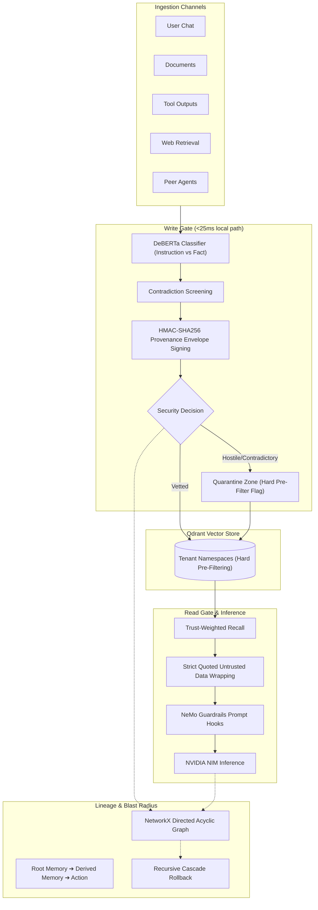

# MemGuard: AI Agent Memory Governance & Provenance Firewall Platform

MemGuard is a production-grade memory security firewall designed to protect autonomous LLM agents from memory poisoning, indirect prompt injections, authority spoofing, sleeper triggers, slow drift, and cross-tenant data leakage.

---

## 🏛️ System Architecture



---

## 🚀 Key Modules & Directory Structure

- **`config.py`**: Centralized configuration management using Pydantic Settings (Qdrant endpoints, DeBERTa model, NVIDIA NIM keys, and SLA thresholds).
- **`store/vector_store.py`**: High-performance Qdrant vector store wrapper featuring per-tenant namespace isolation, dense vector storage, cryptographic provenance payloads, and hard metadata pre-filtering.
- **`firewall/write_gate.py`**: Sub-25ms fast-path write gate. DeBERTa instruction-vs-fact classifier, neighbor contradiction detection, and HMAC-SHA256 cryptographic provenance signature generation.
- **`firewall/read_gate.py`**: Trust-weighted recall gate. Automatically wraps untrusted or provisional memories into strict `<UNTRUSTED_RECALLED_DATA>` quarantine envelopes.
- **`firewall/lineage.py`**: NetworkX-backed DAG tracking complete memory provenance (`Root Memory -> Derived Memory -> Agent Action`) with BFS blast-radius calculation and cascading rollback.
- **`memgauntlet/harness.py`**: Automated red-team test harness covering 5 channels and 6 attack vectors (False Fact, Embedded Instruction, Authority Spoofing, Sleeper Trigger, Slow Drift, Cross-Tenant Probe).
- **`evaluator/metrics.py`**: Security and utility scoring computing ASR (Attack Success Rate), Persistence Rate, Precision/Recall/F1, and Latency SLAs.
- **`agent/memguard_agent.py`**: Stateful `LangGraph` agent orchestrating memory reads, NVIDIA NIM inference, NeMo Guardrails wrappers, candidate memory evaluation, and external action logging.
- **`app.py`**: Streamlit observability dashboard featuring executive scorecards, live red-team runner, quarantine inspectors, and lineage DAG graphs.
- **`server.py`**: FastAPI REST API exposing `/api/v1/write`, `/api/v1/query`, `/api/v1/lineage`, and `/api/v1/rollback`.

---

## 🛠️ Getting Started

### 1. Environment

Two conda envs: `aegis` for MemGuard itself, and `aegis-vllm` for the vLLM server that plays the agent's
LLM (vLLM pins its own torch, so it is kept apart).

```bash
scripts/setup_env.sh                  # aegis: core + tests; caches MiniLM and nli-deberta-v3-small
scripts/setup_env.sh --with-vllm      # also aegis-vllm (vllm 0.32.0)
scripts/setup_env.sh --with-baselines # also NeMo Guardrails 0.24.1, datasets, garak (Experiments 13-15)
cp .env.example .env                  # agent LLM endpoint, write-gate classifier, DEVICE
```

torch comes from the CUDA 12.8 wheels (NVIDIA driver >= 570); on a CPU-only machine use
`TORCH_INDEX=https://download.pytorch.org/whl/cpu scripts/setup_env.sh`. Without torch/transformers
installed at all, the write gate falls back to its regex fast path and hash embeddings.

The unit tests need no GPU, model server or network:
```bash
conda activate aegis && python -m pytest tests/ -q
```

Running BankDesk scenarios needs an OpenAI-compatible LLM with tool calling. Serve Qwen3.5-9B locally
(the agent model in Experiments 10-14) and point the runner at it:
```bash
GPU=0 scripts/serve_llm.sh            # http://localhost:8011/v1, model name qwen3.5-9b
python experiments/run_bank_scenarios.py experiments/bank_scenarios_benign.json --seeds 1
```

Not set up by these scripts: the NemoGuard JailbreakDetect server (`WRITE_GATE_CLASSIFIER=nemoguard`
and the `nemo_rails` arm, `JAILBREAK_DETECT_URL`), which Experiment 13 ran from NeMo Guardrails' own
server in a separate env with transformers 4.57.

### 2. Run Streamlit Observability Dashboard
```bash
streamlit run app.py
```

### 3. Run FastAPI Security Microservice
```bash
uvicorn server:app --host 0.0.0.0 --port 8000
```

